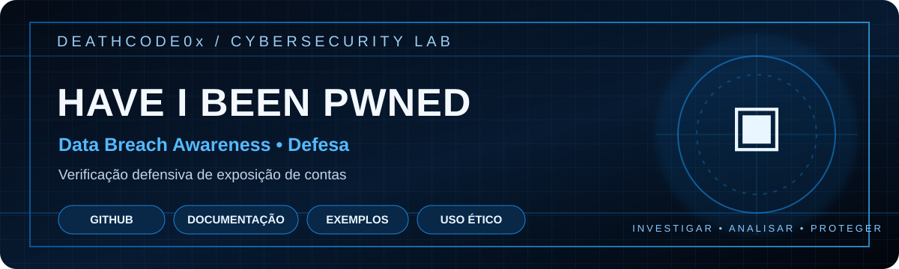

  
  
  
  

> Verificação defensiva de exposição de contas em incidentes conhecidos.

  

---

# Have I Been Pwned

Anotações para compreender e utilizar o serviço Have I Been Pwned (HIBP) na verificação defensiva de exposição de contas.

## Objetivo
Ajudar usuários e equipes a verificar se endereços de e-mail sob sua responsabilidade aparecem em incidentes de dados conhecidos e orientar ações de proteção.

## Procedimento recomendado
1. Verifique somente endereços próprios ou para os quais exista autorização.
2. Acesse o serviço oficial: https://haveibeenpwned.com/
3. Se houver exposição, troque a senha afetada e qualquer senha reutilizada.
4. Ative autenticação multifator (MFA).
5. Revise sessões ativas, regras de encaminhamento e métodos de recuperação.
6. Monitore tentativas de phishing relacionadas ao incidente.

## API e segredos
Consulte a documentação oficial antes de integrar a API: https://haveibeenpwned.com/API/v3

- Não publique API keys.
- Não armazene senhas em texto puro.
- Não envie listas de terceiros sem base legal e autorização.
- Respeite limites de uso e requisitos da API.

## Aviso legal
Este repositório não contém bases vazadas nem credenciais. Não solicite, publique ou compartilhe senhas ou dados obtidos em vazamentos. Utilize o serviço apenas para proteção de contas autorizadas.
